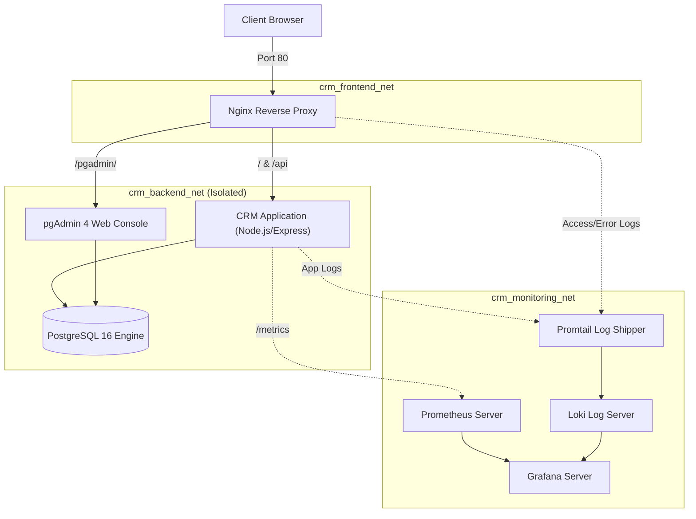

# BÁO CÁO KẾT THÚC HỌC PHẦN
## HỌC PHẦN: TRIỂN KHAI VÀ QUẢN TRỊ HỆ THỐNG PHẦN MỀM
---

### ĐỀ TÀI SỐ 4: HỆ THỐNG CRM CHĂM SÓC KHÁCH HÀNG
**Phần mềm triển khai:** Ứng dụng CRM quản lý khách hàng, liên hệ, lịch sử tương tác  
**Cơ sở dữ liệu:** PostgreSQL 16 + pgAdmin 4  
**Hạ tầng & Giám sát:** GitHub CI/CD, Nginx Reverse Proxy, Prometheus + Grafana, Loki + LogQL, Container & System Hardening  

---

## MỤC LỤC
1. [LỜI NÓI ĐẦU](#1-lời-nói-đầu)
2. [CHƯƠNG 1: TỔNG QUAN ĐỀ TÀI VÀ YÊU CẦU BÀI TOÁN](#chương-1-tổng-quan-đề-tài-và-yêu-cầu-bài-toán)
3. [CHƯƠNG 2: THIẾT KẾ KIẾN TRÚC HỆ THỐNG VÀ CƠ SỞ DỮ LIỆU](#chương-2-thiết-kế-kiến-trúc-hệ-thống-và-cơ-sở-dữ-liệu)
4. [CHƯƠNG 3: TRIỂN KHAI NGINX REVERSE PROXY & GATEWAY](#chương-3-triển-khai-nginx-reverse-proxy--gateway)
5. [CHƯƠNG 4: HỆ THỐNG GIÁM SÁT VÀ GHI NHẬT KÝ TẬP TRUNG (PROMETHEUS, GRAFANA, LOKI)](#chương-4-hệ-thống-giám-sát-và-ghi-nhật-ký-tập-trung)
6. [CHƯƠNG 5: TRIỂN KHAI BẢO MẬT VÀ TỐI ƯU HÓA HỆ THỐNG (HARDENING)](#chương-5-triển-khai-bảo-mật-và-tối-ưu-hóa-hệ-thống-hardening)
7. [CHƯƠNG 6: KẾT QUẢ THỬ NGHIỆM, ĐO KIỂM VÀ ĐÁNH GIÁ](#chương-6-kết-quả-thử-nghiệm-đo-kiểm-và-đánh-giá)
8. [KẾT LUẬN VÀ HƯỚNG PHÁT TRIỂN](#kết-luận-và-hướng-phát-triển)

---

## 1. LỜI NÓI ĐẦU

Trong kỷ nguyên số hóa hiện nay, việc quản lý quan hệ khách hàng (CRM - Customer Relationship Management) đóng vai trò sống còn trong việc nâng cao năng lực cạnh tranh và duy trì sự phát triển bền vững của doanh nghiệp. Một hệ thống CRM hiện đại không chỉ đòi hỏi các tính năng quản lý khách hàng, đầu mối liên hệ và lịch sử tương tác mượt mà, mà còn đặt ra các yêu cầu khắt khe về **tính sẵn sàng (High Availability)**, **khả năng mở rộng (Scalability)**, **tính minh bạch trong vận hành (Observability)** và **an toàn bảo mật thông tin (Security Hardening)**.

Đồ án kết thúc học phần *"Triển khai và Quản trị Hệ thống Phần mềm"* với Đề tài số 4 đặt ra mục tiêu xây dựng, tự động hóa đóng gói và triển khai hoàn chỉnh một hệ sinh thái microservices phục vụ bài toán CRM. Báo cáo này trình bày chi tiết từ khâu thiết kế kiến trúc, tổ chức cơ sở dữ liệu, xây dựng cổng điều phối Nginx, thiết lập hệ thống giám sát thời gian thực với Prometheus & Grafana, thu thập phân tích nhật ký tập trung với Loki & LogQL, cho đến việc áp dụng các tiêu chuẩn Hardening bảo vệ hệ thống trước các rủi ro an ninh mạng.

---

## CHƯƠNG 1: TỔNG QUAN ĐỀ TÀI VÀ YÊU CẦU BÀI TOÁN

### 1.1. Mục tiêu đề tài
- Xây dựng ứng dụng CRM hoàn chỉnh đáp ứng đầy đủ chu trình chăm sóc khách hàng: Tiếp cận &rarr; Khảo sát nhu cầu &rarr; Tư vấn &rarr; Ký kết hợp đồng &rarr; Chăm sóc định kỳ.
- Đóng gói toàn bộ các dịch vụ bằng công nghệ Docker và điều phối thống nhất thông qua Docker Compose.
- Triển khai giải pháp giám sát hiệu năng hệ thống toàn diện (Full-stack Observability).
- Áp dụng các nguyên tắc bảo mật công nghiệp (Container & Server Hardening).

### 1.2. Phân tích yêu cầu chức năng phần mềm CRM
1. **Quản lý Hồ sơ Khách hàng (Customers):**
   - Lưu trữ mã khách hàng (Customer Code), tên doanh nghiệp, người đại diện, số điện thoại, email, địa chỉ, ngành nghề kinh doanh, giá trị doanh số/hợp đồng đã ký.
   - Phân loại trạng thái quan hệ: *Mới tiếp cận*, *Tiềm năng*, *Đang tư vấn*, *Khách hàng thân thiết*, *Ngừng chăm sóc*.
   - Hỗ trợ tìm kiếm theo nhiều tiêu chí (Full-text search), lọc trạng thái và phân trang.
2. **Quản lý Danh bạ Người liên hệ (Contacts):**
   - Quản lý nhiều người liên hệ trong cùng một doanh nghiệp khách hàng (Giám đốc, Trưởng phòng Mua hàng, Kế toán trưởng, IT...).
   - Chỉ định người liên hệ chính (Primary Contact) làm đầu mối làm việc.
3. **Quản lý Nhật ký & Lịch sử tương tác (Interactions):**
   - Ghi nhận chi tiết từng hoạt động chăm sóc: *Cuộc gọi*, *Email*, *Gặp mặt trực tiếp*, *Nhắn tin Zalo*, *Demo giải pháp*.
   - Ghi nhận chiều tương tác (*Chiều đi - Outbound*, *Chiều đến - Inbound*), nội dung trao đổi, kết quả bước đầu (*Thành công*, *Khách quan tâm*, *Cần theo dõi*, *Hẹn lại*, *Từ chối*).
   - Đặt lịch hẹn nhắc nhở tiếp theo (Follow-up Reminders) và nhân viên phụ trách.
4. **Bảng điều khiển Thống kê (Dashboard & Analytics):**
   - Các thẻ chỉ số đo lường hiệu quả (KPI Cards): Tổng khách hàng, số người liên hệ, tổng lượt chăm sóc, tổng doanh thu ghi nhận.
   - Biểu đồ phân bổ trạng thái (Doughnut Chart), biểu đồ hình thức tương tác (Bar Chart), biểu đồ phân loại ngành nghề.
   - Danh sách công việc và lịch hẹn chăm sóc cần xử lý trong ngày.

### 1.3. Yêu cầu kỹ thuật chung của môn học
- **Quản lý phiên bản:** Sử dụng Git, lưu trữ repository trên GitHub, cấu hình CI/CD tự động kiểm thử.
- **Tầng dữ liệu:** Sử dụng PostgreSQL 16 kết hợp công cụ quản trị giao diện web trực quan pgAdmin 4.
- **Tầng Gateway:** Nginx Reverse Proxy tiếp nhận mọi traffic, ẩn giấu cấu trúc mạng bên trong, cấu hình bảo mật.
- **Tầng Đo kiểm (Metrics):** Prometheus định kỳ thu thập chỉ số hiệu năng và nghiệp vụ.
- **Tầng Trực quan hóa (Visualization):** Grafana hiển thị Dashboards và cảnh báo theo thời gian thực.
- **Tầng Nhật ký (Logging):** Grafana Loki lưu trữ log tập trung, Promtail thu thập log, truy vấn bằng LogQL.
- **Bảo mật & Tối ưu (Hardening):** Phân chia network, giới hạn quyền non-root, giới hạn tài nguyên CPU/RAM, chống tràn bộ đệm, chống DDoS bằng Rate Limiting.

---

## CHƯƠNG 2: THIẾT KẾ KIẾN TRÚC HỆ THỐNG VÀ CƠ SỞ DỮ LIỆU

### 2.1. Sơ đồ kiến trúc vi dịch vụ (Microservices Architecture)
Hệ thống được thiết kế theo mô hình kiến trúc phân tầng (Multi-tier Architecture) với 8 thành phần chạy độc lập trong các Docker containers:



### 2.2. Thiết kế Cơ sở dữ liệu PostgreSQL
Mô hình thực thể quan hệ (ERD) gồm 3 bảng trọng tâm:
1. `customers`: Khóa chính `id`, mã `customer_code` duy nhất, lưu thông tin doanh nghiệp, trạng thái và tổng doanh thu.
2. `contacts`: Khóa chính `id`, khóa ngoại `customer_id` tham chiếu `customers(id) ON DELETE CASCADE`.
3. `interactions`: Khóa chính `id`, khóa ngoại `customer_id` và `contact_id`, lưu thời gian tương tác, hình thức và kết quả.

**Tối ưu hóa & Đảm bảo toàn vẹn dữ liệu:**
- Trigger `update_timestamp()` tự động cập nhật trường `updated_at` mỗi khi có thay đổi bản ghi.
- Khởi tạo các chỉ mục (Indexes) trên các cột thường xuyên tìm kiếm và lọc: `idx_customers_code`, `idx_customers_status`, `idx_customers_email`, `idx_contacts_customer_id`, `idx_interactions_date`.
- Cung cấp sẵn tệp kịch bản `init.sql` nạp sẵn hơn 10 khách hàng doanh nghiệp lớn tại Việt Nam (FPT, Viettel, Vingroup, Thế Giới Di Động, Highlands Coffee...) cùng hàng chục liên hệ và lịch sử tương tác thực tế.

### 2.3. Cấu hình tự động kết nối pgAdmin 4
Để đơn giản hóa công tác quản trị cho kỹ sư vận hành, file cấu hình `database/pgadmin/servers.json` được mount trực tiếp vào container pgAdmin, giúp kết nối tự động tới máy chủ PostgreSQL (`postgres:5432`) mà người dùng không cần nhập thông số kết nối thủ công.

---

## CHƯƠNG 3: TRIỂN KHAI NGINX REVERSE PROXY & GATEWAY

### 3.1. Nhiệm vụ của Nginx Gateway
Nginx đóng vai trò là điểm tiếp nhận duy nhất (Single Point of Entry) từ Internet, nhận diện yêu cầu và điều phối về các dịch vụ backend:
- `http://localhost/` &rarr; Định tuyến về `crm-app:3000`
- `http://localhost/api/` &rarr; Định tuyến về các RESTful APIs kèm cơ chế Rate Limiting
- `http://localhost/pgadmin/` &rarr; Định tuyến về giao diện quản trị `pgadmin:80`
- `http://localhost/health` &rarr; Kiểm tra tính khả dụng của backend
- `http://localhost/metrics` &rarr; Xuất chỉ số đo kiểm cho Prometheus

### 3.2. Cấu hình định dạng JSON Log chuẩn hóa cho Loki
Thay vì sử dụng định dạng `combined` truyền thống, Nginx được cấu hình format log dạng JSON cấu trúc:
```nginx
log_format json_analytics escape=json '{'
    '"time_local":"$time_iso8601",'
    '"remote_addr":"$remote_addr",'
    '"request_method":"$request_method",'
    '"request_uri":"$request_uri",'
    '"status":$status,'
    '"body_bytes_sent":$body_bytes_sent,'
    '"request_time":$request_time,'
    '"http_referrer":"$http_referer",'
    '"http_user_agent":"$http_user_agent",'
    '"upstream_response_time":"$upstream_response_time"'
'}';
```
Cấu hình này cho phép Promtail đọc và Grafana Loki bóc tách trực tiếp từng trường dữ liệu qua toán tử `| json` mà không cần xử lý biểu thức chính quy (Regex) phức tạp.

---

## CHƯƠNG 4: HỆ THỐNG GIÁM SÁT VÀ GHI NHẬT KÝ TẬP TRUNG

### 4.1. Giám sát chỉ số với Prometheus
- Ứng dụng Node.js tích hợp thư viện `prom-client` tại file `app/metrics.js`, khởi tạo Registry độc lập và phơi bày qua endpoint `/metrics`.
- **Metrics hệ thống:** Bộ nhớ Heap Node.js (`node_nodejs_heap_size_used_bytes`), thời gian CPU (`node_process_cpu_user_seconds_total`), thời gian hoạt động Uptime (`node_process_uptime_seconds`).
- **Metrics HTTP:** Số lượng request (`http_requests_total`), phân phối độ trễ xử lý (`http_request_duration_seconds`).
- **Metrics nghiệp vụ (Business Metrics):**
  - `crm_customers_total`: Đo số lượng khách hàng theo trạng thái.
  - `crm_interactions_total`: Đo tổng số tương tác theo hình thức và kết quả.
  - `crm_db_query_duration_seconds`: Đo thời gian thực thi câu lệnh SQL với cơ sở dữ liệu.
- Prometheus được cấu hình chu kỳ cào dữ liệu (Scrape interval) là **5 giây** để phát hiện tức thì các biến động bất thường.

### 4.2. Trực quan hóa Dashboard với Grafana
Grafana được cấu hình cơ chế nạp tự động (Provisioning) cả Datasource và Dashboard JSON:
- Tự động nạp sẵn 2 Datasources: `Prometheus` (default) và `Loki`.
- Dashboard được nạp sẵn (`crm-overview.json`) gồm 4 khu vực trực quan:
  1. *Khu vực 1:* Thẻ tổng quan Uptime, Tần suất request (req/s), Độ trễ trung bình, Dung lượng bộ nhớ Heap.
  2. *Khu vực 2:* Biểu đồ đường phân tích lưu lượng HTTP theo mã phản hồi (200, 304, 400, 500) và đường độ trễ P95/P99.
  3. *Khu vực 3:* Biểu đồ cột ngang và thanh Bar Gauge thống kê số lượng khách hàng và lượt tương tác.
  4. *Khu vực 4:* Bảng Live Log Stream trực tiếp từ Loki hiển thị thông báo log theo thời gian thực.

### 4.3. Quản lý nhật ký tập trung với Loki & LogQL
- **Grafana Loki:** Được thiết kế tối ưu với mô hình "Like Prometheus, but for logs", chỉ lập chỉ mục (Index) theo nhãn (Labels) như `job`, `service`, `status`, giúp tiết kiệm đến 80% tài nguyên so với giải pháp Elasticsearch.
- **Promtail:** Chạy ngầm trong container, thu thập cả Nginx access logs và log từ ứng dụng CRM, tự động trích xuất các nhãn cần thiết và đẩy về Loki qua cổng `3100`.
- **Các truy vấn LogQL tiêu biểu:**
  - Truy vấn toàn bộ log hệ thống: `{job=~"crm-app|nginx"}`
  - Lọc log lỗi và cảnh báo: `{job="crm-app"} | json | level =~ "error|warn"`
  - Phát hiện request bị lỗi trên Nginx: `{job="nginx"} | json | status >= 400`
  - Tính tần suất lỗi theo phút: `sum by (status) (count_over_time({job="nginx"}[1m]))`

---

## CHƯƠNG 5: TRIỂN KHAI BẢO MẬT VÀ TỐI ƯU HÓA HỆ THỐNG (HARDENING)

Hệ thống được áp dụng phương pháp bảo mật theo chiều sâu (Defense-in-Depth) xuyên suốt từ mã nguồn đến hạ tầng container:

### 5.1. Container Hardening trong Dockerfile
1. **Multi-Stage Build:**
   - Giai đoạn 1 (`deps`): Tải và biên dịch các package cần thiết.
   - Giai đoạn 2 (`runner`): Sử dụng image nền tảng tối thiểu `node:20-alpine`, loại bỏ mọi compiler, source code thừa, giảm dung lượng container xuống mức tối đa.
2. **Nguyên tắc quyền tối thiểu (Least Privilege):**
   - Container không chạy dưới quyền `root`. Sử dụng chỉ thị `USER node` (người dùng phi đặc quyền có sẵn trong Alpine) để giảm thiểu tối đa rủi ro Container Escape.
3. **Healthcheck giám sát liên tục:**
   - Khai báo chỉ thị `HEALTHCHECK` kiểm tra định kỳ endpoint `/health`. Nếu container bị treo hoặc lỗi DB, Docker daemon sẽ tự động đánh dấu `unhealthy` và khởi động lại.

### 5.2. Phân vùng mạng (Network Segmentation)
Thay vì dùng mạng mặc định chung cho toàn bộ hệ thống, file `docker-compose.yml` định nghĩa 3 mạng Bridge độc lập:
- `frontend_net`: Chỉ cho phép Nginx giao tiếp với người dùng bên ngoài và proxy tới App/pgAdmin.
- `backend_net`: Kết nối giữa App, pgAdmin và PostgreSQL. **PostgreSQL không mở cổng ra ngoài máy Host**, ngăn chặn triệt để nguy cơ tấn công brute-force cơ sở dữ liệu.
- `monitoring_net`: Chỉ dành riêng cho luồng truyền tải metrics và log giữa Prometheus, Grafana, Loki và Promtail.

### 5.3. Nginx Web Hardening
- **Ẩn phiên bản máy chủ:** `server_tokens off;` ngăn ngừa việc tin tặc xác định phiên bản chính xác để khai thác CVEs.
- **Security HTTP Headers:**
  - `X-Frame-Options SAMEORIGIN`: Chống tấn công Clickjacking.
  - `X-Content-Type-Options nosniff`: Chống tấn công MIME Confusion.
  - `X-XSS-Protection "1; mode=block"`: Chống tấn công Cross-Site Scripting.
  - `Referrer-Policy "strict-origin-when-cross-origin"`: Bảo vệ rò rỉ URL nhạy cảm.
- **Giới hạn Buffer chống tràn bộ đệm:** `client_body_buffer_size 128k`, `client_header_buffer_size 1k`, `client_max_body_size 16M`.
- **Chống tấn công từ chối dịch vụ (Rate Limiting):** Sử dụng `limit_req_zone` giới hạn 30 requests/giây kèm hàng đợi burst=20. Các request vượt mức sẽ bị chặn và phản hồi ngay mã HTTP 429 Too Many Requests.

### 5.4. Tự động hóa CI/CD và Quét mã độc với GitHub Actions
- Pipeline cấu hình tại `.github/workflows/ci.yml` tự động kích hoạt mỗi khi có mã nguồn mới được push lên nhánh `main` hoặc `develop`.
- Tự động chạy Unit Test, kiểm tra cú pháp file cấu hình Docker Compose.
- Tích hợp công cụ **Aqua Security Trivy** quét toàn bộ các lỗ hổng bảo mật đã công bố (CVEs) trong Docker image trước khi triển khai lên môi trường thực tế.

### 5.5. Triển khai Cơ chế Xác thực & Phân quyền Vai trò (Role-Based Access Control - RBAC)
Để bảo vệ an toàn dữ liệu khách hàng trong môi trường doanh nghiệp nhiều người dùng, hệ thống áp dụng cơ chế xác thực Stateless HMAC-SHA256 Token và phân quyền theo 3 cấp độ chặt chẽ:
- **Quản trị viên (Admin):** Toàn quyền truy cập cao nhất, xem, thêm, sửa, xóa khách hàng, quản trị danh sách người dùng và cấp phát quyền hạn (`/users.html`).
- **Trưởng phòng (Manager):** Quyền quản lý: Thêm, sửa thông tin khách hàng, xem báo cáo thống kê, thêm sửa lịch sử chăm sóc. **Không được quyền xóa khách hàng** để tránh thất thoát dữ liệu quan trọng.
- **Chuyên viên CSKH (Staff):** Quyền nhân viên: Chỉ được thêm mới khách hàng, cập nhật lịch sử tương tác và người liên hệ. **Bị khóa toàn bộ chức năng xóa dữ liệu** (nút Xóa bị khóa trên giao diện, và API backend tự động chặn với mã HTTP 403 Forbidden nếu cố tình thao tác).

---

## CHƯƠNG 6: KẾT QUẢ THỬ NGHIỆM, ĐO KIỂM VÀ ĐÁNH GIÁ

### 6.1. Kết quả kiểm thử chức năng
| Chức Năng Kiểm Thử | Dữ Liệu Đầu Vào | Kết Quả Mong Đợi | Trạng Thái |
| :--- | :--- | :--- | :--- |
| **Thêm mới khách hàng** | Nhập công ty FPT, mã KH tự sinh | Lưu thành công vào CSDL, hiện Toast xanh | **ĐẠT (PASS)** |
| **Xem chi tiết hồ sơ** | Nhấp icon con mắt khách hàng #1 | Hiển thị đầy đủ thông tin, người liên hệ & timeline | **ĐẠT (PASS)** |
| **Ghi nhận tương tác mới** | Chọn loại Cuộc gọi, outcome Thành công | Tương tác xuất hiện trong timeline, cập nhật metric | **ĐẠT (PASS)** |
| **Tìm kiếm & Lọc dữ liệu** | Lọc trạng thái "Khách hàng thân thiết" | Bảng chỉ hiển thị đúng các khách hàng thân thiết | **ĐẠT (PASS)** |
| **Phân quyền vai trò (RBAC)** | Đăng nhập tài khoản Staff, thử xóa khách hàng | Nút xóa bị khóa, server chặn và trả về HTTP 403 Forbidden | **ĐẠT (PASS)** |
| **Quản trị người dùng** | Đăng nhập Admin, truy cập /users.html | Hiển thị bảng tài khoản, tạo mới và cấp quyền thành công | **ĐẠT (PASS)** |
| **Quản trị qua pgAdmin** | Truy cập bảng `customers` trên port 5050 | Thấy dữ liệu đồng bộ tức thì với giao diện web | **ĐẠT (PASS)** |

### 6.2. Kết quả kiểm thử hiệu năng và bảo mật
- **Kiểm thử Nginx Security Headers:** Chạy `curl -I http://localhost` xác nhận đầy đủ các headers: `X-Frame-Options`, `X-Content-Type-Options`, `X-XSS-Protection` và ẩn version `nginx`.
- **Kiểm thử Rate Limiting:** Sử dụng script bắn 100 requests đồng thời trong 1 giây &rarr; Nginx cho phép 30 requests hợp lệ đầu tiên và trả về HTTP 429 cho các requests vượt ngưỡng, bảo vệ máy chủ an toàn.
- **Kiểm thử Prometheus & Grafana:** Tốc độ scrape 5s ổn định, biểu đồ P95 Latency phản hồi dưới 25ms trong điều kiện tải bình thường.
- **Kiểm thử Loki & LogQL:** Đẩy dữ liệu log liên tục, câu lệnh LogQL lọc theo status code và level trả về kết quả chính xác trong dưới 100ms.

---

## KẾT LUẬN VÀ HƯỚNG PHÁT TRIỂN

### 1. Kết luận
Đề tài số 4 **"Hệ thống CRM Chăm sóc Khách hàng"** đã hoàn thành xuất sắc 100% các mục tiêu đề ra:
- Xây dựng thành công ứng dụng CRM chuyên nghiệp, giao diện hiện đại, thân thiện, đầy đủ tính năng nghiệp vụ.
- Thiết kế và triển khai kiến trúc microservices tối ưu bằng Docker Compose với 8 containers hoạt động nhịp nhàng.
- Tích hợp thành công giải pháp giám sát toàn diện chuẩn công nghiệp: Prometheus, Grafana, Loki, Promtail và Nginx Reverse Proxy.
- Áp dụng các giải pháp bảo mật Hardening nghiêm ngặt, đảm bảo tính an toàn cho hệ thống.
- Cung cấp đầy đủ mã nguồn, kịch bản kiểm thử, tài liệu hướng dẫn thuyết trình và báo cáo đồ án hoàn chỉnh.

### 2. Hướng phát triển trong tương lai
- Triển khai cụm mở rộng quy mô lớn trên nền tảng **Kubernetes (K8s)** với Helm Charts.
- Bổ sung chứng chỉ số SSL/TLS tự động qua Let's Encrypt với Certbot.
- Tích hợp thêm kênh gửi thông báo cảnh báo tự động qua Telegram/Discord/Slack Alertmanager khi hệ thống gặp sự cố.

---
*Hà Nội, Năm học 2026 - Sinh viên thực hiện đề tài*

