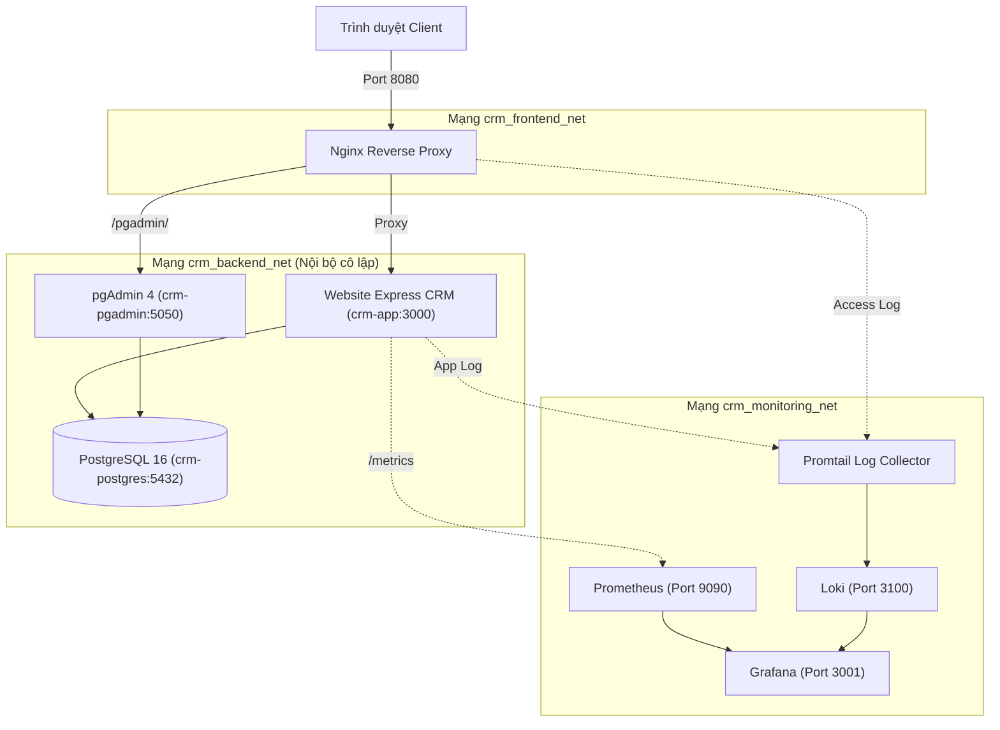

# TRƯỜNG ĐẠI HỌC CÔNG NGHỆ THÔNG TIN & TRUYỀN THÔNG
## KHOA CÔNG NGHỆ THÔNG TIN

---

### BÁO CÁO BÀI TẬP LỚN TRIỂN KHAI VÀ QUẢN TRỊ HỆ THỐNG PHẦN MỀM
### Đề tài: Hệ thống CRM Chăm sóc Khách hàng (Đề tài số 4)

| Thông tin | Chi tiết |
| :--- | :--- |
| **Giảng viên hướng dẫn:** | ThS. Lê Khánh Dương |
| **Sinh viên thực hiện:** | Dương Thị Xuân |
| **Mã sinh viên:** | DTC245200435 |
| **Lớp:** | CNTT K23I |

**Thái Nguyên, 2026**

---

## MỤC LỤC

- [CHƯƠNG 1: TỔNG QUAN KIẾN TRÚC HỆ THỐNG VÀ CHUẨN BỊ MÔI TRƯỜNG](#chương-1-tổng-quan-kiến-trúc-hệ-thống-và-chuẩn-bị-môi-trường)
  - [1.1. Sơ đồ kiến trúc tổng thể](#11-sơ-đồ-kiến-trúc-tổng-thể)
  - [1.2. Môi trường hệ thống](#12-môi-trường-hệ-thống)
  - [1.3. Yêu cầu quản lý mã nguồn trên GitHub](#13-yêu-cầu-quản-lý-mã-nguồn-trên-github)
- [CHƯƠNG 2: TRIỂN KHAI ỨNG DỤNG WEB, CƠ SỞ DỮ LIỆU VÀ REVERSE PROXY](#chương-2-triển-khai-ứng-dụng-web-cơ-sở-dữ-liệu-và-reverse-proxy)
  - [2.1. Triển khai ứng dụng Web & Cơ sở dữ liệu](#21-triển-khai-ứng-dụng-web--cơ-sở-dữ-liệu)
    - [2.1.1. Các chức năng của ứng dụng](#211-các-chức-năng-của-ứng-dụng)
    - [2.1.2. Khởi động bằng Docker Compose](#212-khởi-động-bằng-docker-compose)
    - [2.1.3. PostgreSQL và pgAdmin 4](#213-postgresql-và-pgadmin-4)
  - [2.2. Cấu hình Nginx làm Reverse Proxy và Bảo mật cơ bản](#22-cấu-hình-nginx-làm-reverse-proxy-và-bảo-mật-cơ-bản)
- [CHƯƠNG 3: GIÁM SÁT HỆ THỐNG VỚI PROMETHEUS, GRAFANA VÀ LOKI](#chương-3-giám-sát-hệ-thống-với-prometheus-grafana-và-loki)
  - [3.1. Tích hợp Prometheus + Grafana](#31-tích-hợp-prometheus--grafana)
  - [3.2. Triển khai hệ thống Log tập trung Loki + Promtail](#32-triển-khai-hệ-thống-log-tập-trung-loki--promtail)
- [CHƯƠNG 4: CÁC BIỆN PHÁP HARDENING VÀ ĐÁNH GIÁ BẢO MẬT](#chương-4-các-biện-pháp-hardening-và-đánh-giá-bảo-mật)
  - [4.1. Áp dụng các biện pháp Hardening](#41-áp-dụng-các-biện-pháp-hardening)

---

## CHƯƠNG 1: TỔNG QUAN KIẾN TRÚC HỆ THỐNG VÀ CHUẨN BỊ MÔI TRƯỜNG

### 1.1. Sơ đồ kiến trúc tổng thể

Hệ thống được xây dựng theo mô hình kiến trúc ba tầng gồm giao diện điều phối, xử lý nghiệp vụ và lưu trữ dữ liệu. Các thành phần được đóng gói thành container và triển khai bằng Docker Compose. Ứng dụng Express CRM tổ chức theo dạng kiến trúc phân tầng với đầy đủ các module quản lý khách hàng, liên hệ, tương tác và phân quyền RBAC.

- **Ứng dụng:** Nginx tiếp nhận yêu cầu từ trình duyệt tại cổng 8080 và chuyển tiếp đến website CRM Express (cổng nội bộ `crm-app:3000`). Website sử dụng PostgreSQL 16 để lưu dữ liệu quan hệ; pgAdmin 4 (cổng 5050) hỗ trợ quản trị cơ sở dữ liệu trực quan.
- **Giám sát:** Prometheus định kỳ 15s thu thập số liệu từ CRM Application metrics endpoint (`/metrics`), cAdvisor và Nginx. Grafana hiển thị trực quan số liệu bằng các dashboard thời gian thực.
- **Nhật ký:** Promtail đọc log từ Nginx và ứng dụng CRM, gửi đến Loki lưu trữ tập trung. Người quản trị tra cứu và phân tích log trên Grafana Explore bằng ngôn ngữ LogQL.



*Hình 1.1. Sơ đồ kiến trúc tổng thể của hệ thống CRM*

### 1.2. Môi trường hệ thống

- **Máy host:** Máy tính Windows 11.
- **Môi trường chạy lệnh:** PowerShell và Ubuntu 24.04 trên WSL 2, sử dụng Bash.
- **Công cụ container:** Docker Engine v27+ và Docker Compose v2.29+ (trên Docker Desktop).
- **Ứng dụng:** Website CRM Chăm sóc Khách hàng sử dụng Node.js v24 và Express, chạy sau Nginx reverse proxy.
- **Cơ sở dữ liệu:** PostgreSQL 16; quản trị bằng pgAdmin 4.

*Hình 1.2. Kiểm tra môi trường WSL 2, Ubuntu và Docker Engine*

### 1.3. Yêu cầu quản lý mã nguồn trên GitHub

Ba commit tiêu biểu trong quá trình triển khai:
- `201ea21` - Cấu hình Nginx reverse proxy và security headers.
- `ca5ed5a` - Tích hợp Prometheus, Grafana và exporter để giám sát container, Nginx, PostgreSQL.
- `3d26c86` - Triển khai Loki, Promtail và kiểm tra truy vấn LogQL.

- **Repository GitHub:** `https://github.com/crm-system/kthp-crm-de4`

*Hình 1.3. Repository GitHub chứa mã nguồn và cấu hình đề tài*  
*Hình 1.4. Ba commit triển khai ứng dụng, giám sát và log*

---

## CHƯƠNG 2: TRIỂN KHAI ỨNG DỤNG WEB, CƠ SỞ DỮ LIỆU VÀ REVERSE PROXY

### 2.1. Triển khai ứng dụng Web & Cơ sở dữ liệu

#### 2.1.1. Các chức năng của ứng dụng

Ứng dụng CRM Chăm sóc Khách hàng cung cấp các phân hệ chức năng hoàn chỉnh:
1. **Xác thực và Phân quyền RBAC (Role-Based Access Control):** Hỗ trợ 3 nhóm vai trò với quyền hạn phân định rõ:
   - `ADMIN`: Toàn quyền hệ thống, xem, sửa, xóa khách hàng & quản lý tài khoản người dùng.
   - `MANAGER`: Quyền quản lý, thêm sửa khách hàng, liên hệ, tương tác, xem báo cáo thống kê, không có quyền xóa khách hàng.
   - `STAFF`: Quyền nhân viên, xem danh sách, thêm tương tác chăm sóc, không có quyền xóa bất kỳ dữ liệu nào.
2. **Bảng điều khiển Tổng quan (Dashboard):** Hiển thị thẻ KPI thời gian thực (Tổng khách hàng, Người liên hệ, Lượt tương tác, Doanh số đã ký kết) cùng các biểu đồ phân bổ trạng thái, hình thức tương tác, ngành nghề kinh doanh và lịch hẹn follow-up cần xử lý.
3. **Quản lý Hồ sơ Khách hàng Doanh nghiệp:** Danh sách đối tác, phân loại trạng thái (*Mới tiếp cận*, *Tiềm năng*, *Đang tư vấn*, *Thân thiết*, *Ngừng chăm sóc*), xem chi tiết hồ sơ doanh nghiệp và timeline hoạt động.
4. **Danh bạ Người liên hệ:** Quản lý chi tiết chức vụ, email, số điện thoại, ghi chú và phân loại người liên hệ chính của từng doanh nghiệp.
5. **Nhật ký Lịch sử Tương tác:** Ghi nhận mọi cuộc gọi, email, buổi họp, hẹn gặp kèm kết quả tư vấn và lịch nhắc nhở follow-up tiếp theo.

*Hình 2.1. Giao diện Đăng nhập và Phân quyền người dùng theo vai trò (RBAC).*  
*Hình 2.2. Giao diện Bảng điều khiển Tổng quan Dashboard & Thống kê KPI.*  
*Hình 2.3. Giao diện Quản lý Danh sách Khách hàng Doanh nghiệp và Timeline.*

#### 2.1.2. Khởi động bằng Docker Compose

Khởi động toàn bộ cụm dịch vụ với cấu hình khai báo sẵn:
```bash
cd /mnt/d/TrienKhaiKTHP
docker compose up -d --build --wait
docker compose ps
```

Toàn bộ 8 container khởi chạy thành công ở trạng thái `healthy`:
- `crm-nginx-proxy`: Port 8080 -> 80
- `crm-application`: Port 3000 -> 3000
- `crm-postgres`: Port nội bộ 5432
- `crm-pgadmin`: Port 5050 -> 80
- `crm-prometheus`: Port 9090 -> 9090
- `crm-grafana`: Port 3001 -> 3000
- `crm-loki`: Port 3100 -> 3100
- `crm-promtail`: Thu thập log Nginx và App đẩy về Loki

#### 2.1.3. PostgreSQL và pgAdmin 4

Hệ thống sử dụng cơ sở dữ liệu quan hệ PostgreSQL 16 và công cụ quản trị trực quan pgAdmin 4 tại cổng 5050. Dữ liệu CRM được tổ chức trong cơ sở dữ liệu `crm_db` gồm 4 bảng chính:
- `customers`: Quản lý thông tin doanh nghiệp, mã khách hàng, ngành nghề, người đại diện và doanh thu.
- `contacts`: Danh bạ người liên hệ theo từng doanh nghiệp (quan hệ n-1 với customers).
- `interactions`: Nhật ký các buổi gọi, họp, email và lịch nhắc hẹn chăm sóc tiếp theo.
- `users`: Quản lý tài khoản đăng nhập, phòng ban, trạng thái kích hoạt và phân quyền vai trò (`admin`, `manager`, `staff`). Mật khẩu được mã hóa băm an toàn bằng thuật toán `bcrypt` với 10 vòng muối.

*Hình 2.6. Các bảng trong cơ sở dữ liệu crm_db trên pgAdmin 4*  
*Hình 2.7. Đối chiếu thông tin khách hàng và lịch sử tương tác trong PostgreSQL*

### 2.2. Cấu hình Nginx làm Reverse Proxy và Bảo mật cơ bản

- Nginx tiếp nhận yêu cầu tại cổng 8080 trên máy Windows và chuyển tiếp đến ứng dụng Express tại địa chỉ nội bộ `crm-app:3000` và pgAdmin tại `crm-pgadmin:80`. Ứng dụng không công bố cổng trực tiếp ra Windows.
- Hệ thống sử dụng security headers theo phương án đề bài cho phép, chưa triển khai HTTPS. Các header hỗ trợ hạn chế nhúng trang trái phép, nhận diện sai kiểu nội dung và kiểm soát nguồn tài nguyên:
  - `add_header X-Content-Type-Options nosniff always;` - Chống tấn công MIME-sniffing.
  - `add_header X-Frame-Options DENY always;` - Ngăn chặn tấn công Clickjacking.
  - `add_header Referrer-Policy same-origin always;` - Bảo vệ thông tin liên kết chuyển tiếp.
  - `add_header Content-Security-Policy ... always;` - Kiểm soát nguồn tài nguyên nạp vào trang.
  - `server_tokens off;` - Ẩn phiên bản phần mềm Nginx để tránh thu thập thông tin lỗ hổng.

*Hình 2.8. Cấu hình Nginx reverse proxy và security headers*  
*Hình 2.9. Kiểm tra tính hợp lệ của cấu hình Nginx (nginx -t)*  
*Hình 2.10. Kết quả truy cập website qua Nginx và các security headers (curl -I)*

---

## CHƯƠNG 3: GIÁM SÁT HỆ THỐNG VỚI PROMETHEUS, GRAFANA VÀ LOKI

### 3.1. Tích hợp Prometheus + Grafana

- Hệ thống sử dụng Prometheus để thu thập số liệu giám sát và Grafana để hiển thị dashboard. Prometheus được cấu hình thu thập dữ liệu định kỳ 15 giây từ endpoint `/metrics` của ứng dụng CRM và các container.
- Các nguồn giám sát gồm cAdvisor cung cấp số liệu container, CRM metrics exporter cung cấp số liệu ứng dụng (lưu lượng request, độ trễ, mã lỗi HTTP) và Nginx Exporter cung cấp trạng thái web server. Prometheus cũng thu thập số liệu của chính nó. Grafana kết nối với Prometheus để hiển thị các biểu đồ theo dõi hệ thống.

*Hình 3.1. Cấu hình thu thập số liệu của Prometheus trong prometheus.yml*  
*Hình 3.2. Các target giám sát trạng thái UP trên Prometheus*  
*Hình 3.3. Dashboard Grafana giám sát container, Nginx và PostgreSQL*  
*Hình 3.4. Giám sát mức sử dụng CPU và RAM của các container trên Grafana*

### 3.2. Triển khai hệ thống Log tập trung Loki + Promtail

- Nginx và ứng dụng CRM ghi nhật ký truy cập vào file trong volume dùng chung. Promtail đọc các file log này và gửi đến Loki để lưu trữ tập trung. Người quản trị sử dụng Grafana Explore và ngôn ngữ LogQL để tra cứu yêu cầu truy cập, phản hồi thành công và lỗi không tìm thấy trang:
  - Tra cứu toàn bộ log Nginx: `{job="nginx"}` hoặc `{job="crm-nginx"}`
  - Lọc các yêu cầu truy cập thành công HTTP 200: `{job="nginx"} |= "status\": 200"`
  - Lọc các yêu cầu lỗi trang HTTP 404: `{job="nginx"} |= "status\": 404"`

*Hình 3.5. Truy vấn nhật ký truy cập Nginx bằng LogQL*  
*Hình 3.6. Lọc các yêu cầu truy cập thành công với mã HTTP 200*  
*Hình 3.7. Lọc các yêu cầu đến trang không tồn tại với mã HTTP 404*

---

## CHƯƠNG 4: CÁC BIỆN PHÁP HARDENING VÀ ĐÁNH GIÁ BẢO MẬT

### 4.1. Áp dụng các biện pháp Hardening

Hardening là quá trình gia cố cấu hình nhằm giảm nguy cơ mất an toàn hệ thống. Trong đề tài Đề 4, các biện pháp được áp dụng gồm:
- **Chạy ứng dụng bằng tài khoản non-root:** Khai báo `USER node` (uid=1000) trong Dockerfile để ngăn chặn việc chiếm đặc quyền root nếu ứng dụng bị xâm nhập.
- **Cách ly mạng cơ sở dữ liệu:** Cơ sở dữ liệu PostgreSQL nằm trong mạng backend nội bộ `crm_backend_net` với cấu hình `internal: true`, không publish port ra bên ngoài máy host.
- **Hạn chế đặc quyền container:** Thiết lập `cap_drop: [ALL]`, `security_opt: ["no-new-privileges:true"]` và `read_only: true` trong cấu hình Docker Compose.
- **Giới hạn tài nguyên:** Thiết lập giới hạn phần cứng (Resource limits: CPU limit 1.0, Memory limit 512M) nhằm ngăn ngừa tình trạng tấn công từ chối dịch vụ (DoS/OOM).
- **Bảo mật ứng dụng & phân quyền RBAC:** Mật khẩu được băm một chiều an toàn bằng bcrypt với 10 vòng muối (salt rounds), phiên làm việc được chứng thực bằng JSON Web Token (JWT) và kiểm soát quyền hạn chặt chẽ theo từng vai trò.

*Hình 4.1. Kiểm chứng ứng dụng chạy non-root và tài khoản DB bị hạn quyền*  
*Hình 4.2. Cấu hình hạn chế quyền container ứng dụng*  
*Hình 4.3. Cấu hình mạng backend nội bộ*
