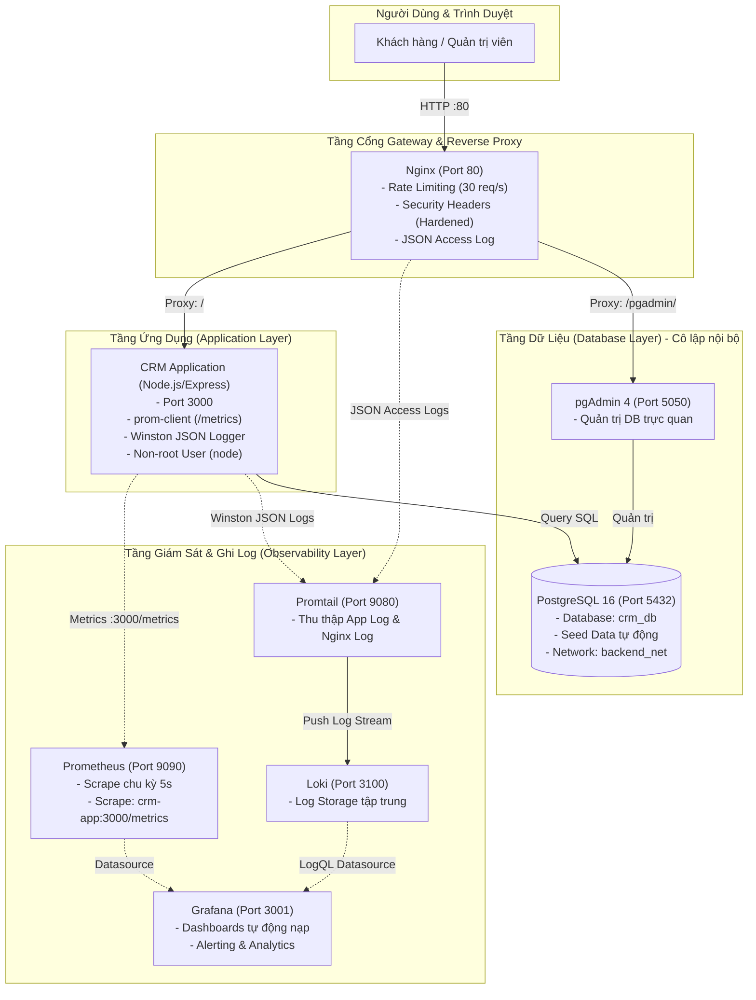

# HỆ THỐNG CRM CHĂM SÓC KHÁCH HÀNG
### Đề tài 4 - Triển khai và Quản trị Hệ thống Phần mềm (KTHP)

[](https://github.com)
[](https://docs.docker.com/compose/)
[](https://www.postgresql.org/)
[](https://nginx.org/)
[](https://prometheus.io/)
[](https://grafana.com/)
[](https://grafana.com/oss/loki/)

---

## 📌 1. Giới Thiệu Dự Án

Dự án triển khai một hệ thống **CRM Chăm sóc Khách hàng** hoàn chỉnh dành cho doanh nghiệp vừa và nhỏ, đáp ứng đầy đủ các tiêu chuẩn kỹ thuật trong học phần **Triển khai và Quản trị Hệ thống Phần mềm**:
- **Ứng dụng CRM**: Quản lý thông tin doanh nghiệp, khách hàng, danh bạ người liên hệ, nhật ký lịch sử chăm sóc (gọi điện, email, họp trực tiếp, khảo sát nhu cầu, nhắc lịch hẹn follow-up) và dashboard thống kê thông minh.
- **Cơ sở dữ liệu**: PostgreSQL 16 Alpine với schema chuẩn hóa, tự động seed dữ liệu mẫu phong phú và hệ thống quản trị trực quan qua pgAdmin 4.
- **Cổng Gateway & Reverse Proxy**: Nginx xử lý định tuyến tập trung, cân bằng tải, nén Gzip, rate limiting chống DDoS và cấu hình bảo mật Security Headers (Hardening).
- **Hệ thống Giám sát & Đo kiểm (Observability)**: Prometheus định kỳ scrape metrics tài nguyên và nghiệp vụ từ endpoint `/metrics`, trực quan hóa qua Grafana với Dashboard được tự động nạp (Provisioning).
- **Hệ thống Thu thập & Phân tích Log tập trung**: Grafana Loki kết hợp Promtail thu thập toàn bộ nhật ký ứng dụng và access log của Nginx, truy vấn linh hoạt bằng ngôn ngữ LogQL.
- **Bảo mật & Tối ưu hóa (Container Hardening)**: Phân tách 3 lớp mạng riêng biệt (Frontend, Backend cô lập, Monitoring), chạy container với quyền non-root user, multi-stage build thu nhỏ image và áp dụng giới hạn tài nguyên CPU/RAM.

---

## 🏛️ 2. Sơ Đồ Kiến Trúc Hệ Thống (Architecture)



---

## 🚀 3. Hướng Dẫn Khởi Động Nhanh (Quick Start)

### Yêu cầu tiên quyết:
- Đã cài đặt **Docker** và **Docker Compose** (ví dụ: Docker Desktop trên Windows/macOS hoặc Docker Engine trên Ubuntu).
- Đảm bảo Docker Daemon đang hoạt động.

### Bước 1: Khởi động hệ thống
Mở Terminal hoặc PowerShell tại thư mục dự án và chạy:

```bash
# Cách 1: Chạy file script tự động (Khuyên dùng trên Windows)
.\scripts\start.bat

# Cách 2: Chạy trực tiếp bằng Docker Compose
docker-compose up -d --build
```

### Bước 2: Kiểm tra trạng thái các container
```bash
docker-compose ps
```
Toàn bộ 8 containers (`crm-application`, `crm-postgres`, `crm-pgadmin`, `crm-nginx-proxy`, `crm-prometheus`, `crm-grafana`, `crm-loki`, `crm-promtail`) sẽ chuyển sang trạng thái `Up` (hoặc `healthy`).

---

## 🌐 4. Bảng Tra Cứu Cổng Dịch Vụ & Tài Khoản Mặc Định

| Dịch Vụ | Địa Chỉ Truy Cập | Tài Khoản Đăng Nhập | Mục Đích Sử Dụng |
| :--- | :--- | :--- | :--- |
| **Ứng dụng CRM (Nginx)** | [http://localhost](http://localhost) | Không yêu cầu | Giao diện chính người dùng & chăm sóc KH |
| **Ứng dụng CRM (Direct)** | [http://localhost:3000](http://localhost:3000) | Không yêu cầu | Truy cập trực tiếp node backend |
| **pgAdmin 4** | [http://localhost:5050](http://localhost:5050) | Email: `admin@crm.local`<br>Pass: `AdminPass@2026` | Quản trị cơ sở dữ liệu PostgreSQL trực quan |
| **Grafana Dashboard** | [http://localhost:3001](http://localhost:3001) | User: `admin`<br>Pass: `admin` | Giám sát tài nguyên, Latency, HTTP status & Logs |
| **Prometheus Web UI** | [http://localhost:9090](http://localhost:9090) | Không yêu cầu | Tra cứu câu lệnh PromQL & kiểm tra targets |
| **Grafana Loki** | [http://localhost:3100](http://localhost:3100) | Không yêu cầu | Cổng nhận log push & LogQL engine |
| **Prometheus Metrics** | [http://localhost/metrics](http://localhost/metrics) | Không yêu cầu | Dữ liệu đo kiểm chuẩn OpenMetrics |
| **Health Check API** | [http://localhost/health](http://localhost/health) | Không yêu cầu | Kiểm tra trạng thái sống của App & PostgreSQL |

---

## 🔍 5. Bộ Câu Truy Vấn Mẫu Phân Tích Log Với LogQL (Loki)

Đăng nhập Grafana ([http://localhost:3001](http://localhost:3001)) &rarr; Chọn **Explore** &rarr; Chọn nguồn dữ liệu **Loki**:

1. **Xem toàn bộ dòng log từ ứng dụng CRM**:
   ```logql
   {job="crm-app"}
   ```

2. **Lọc ra các thông báo log cấp độ ERROR hoặc WARN**:
   ```logql
   {job="crm-app"} | json | level =~ "error|warn"
   ```

3. **Xem các yêu cầu HTTP có mã lỗi 4xx hoặc 5xx trên Nginx Gateway**:
   ```logql
   {job="nginx"} | json | status >= 400
   ```

4. **Đếm tần suất request theo mã phản hồi HTTP trong mỗi phút**:
   ```logql
   sum by (status) (count_over_time({job="nginx"}[1m]))
   ```

5. **Tìm kiếm các thao tác tương tác liên quan đến từ khóa "hợp đồng"**:
   ```logql
   {job="crm-app"} |= "hợp đồng"
   ```

---

## 🛡️ 6. Các Tiêu Chuẩn Bảo Mật & Hardening Đã Áp Dụng

1. **Cô lập mạng nội bộ (Network Segmentation)**:
   - Cơ sở dữ liệu PostgreSQL chỉ nằm trong mạng `backend_net` riêng biệt, không expose port ra ngoài Internet, ngăn ngừa hoàn toàn nguy cơ brute-force database từ bên ngoài.
2. **Quyền người dùng tối thiểu trong Container (Least Privilege)**:
   - `Dockerfile` của ứng dụng CRM sử dụng user `node` (UID 1000) thay vì chạy với quyền `root`.
3. **Multi-Stage Docker Build**:
   - Tách biệt giai đoạn tải dependencies và giai đoạn chạy thực tế, sử dụng image nền tảng `node:20-alpine` siêu nhẹ, giảm thiểu triệt để số lượng package dư thừa và các CVEs tiềm ẩn.
4. **Nginx Security Hardening**:
   - Thiết lập `server_tokens off` nhằm ẩn phiên bản Nginx.
   - Thêm đầy đủ các security HTTP headers: `X-Frame-Options SAMEORIGIN`, `X-Content-Type-Options nosniff`, `X-XSS-Protection`, `Referrer-Policy`.
   - Giới hạn kích thước buffer để phòng chống tấn công tràn bộ đệm (Buffer Overflow).
   - Rate Limiting 30 requests/giây để ngăn ngừa spam API và tấn công từ chối dịch vụ (DoS).
5. **Giới hạn tài nguyên phần cứng (Resource Quotas)**:
   - Mọi container trong file `docker-compose.yml` đều được khai báo cụ thể giới hạn `cpus` và `memory` trần để tránh tình trạng một container làm cạn kiệt tài nguyên máy chủ chủ quản (Host exhaustion).

---

## ⚡ 7. Kịch Bản Giả Lập Tải & Kiểm Thử Hệ Thống

Để tạo dữ liệu biểu đồ sống động và dòng log liên tục phục vụ thuyết trình:
```bash
# Mở một cửa sổ terminal mới và chạy:
node scripts/generate-traffic.js
```
Script sẽ tự động gửi hàng loạt request ngẫu nhiên đến các trang chức năng, API và tạo thêm các bản ghi tương tác mới vào CSDL, giúp các biểu đồ Grafana và log stream trên Loki nhảy số theo thời gian thực!

---

## 📁 8. Cấu Trúc Thư Mục Dự Án

```
├── .github/workflows/ci.yml       # GitHub Actions CI/CD Pipeline (Lint, Test, Docker Build & Trivy Scan)
├── app/                           # Mã nguồn Ứng dụng CRM (Node.js, Express, Winston, prom-client)
│   ├── public/                    # Giao diện Web hiện đại (HTML5, Bootstrap 5, Chart.js)
│   │   ├── index.html             # Dashboard tổng quan
│   │   ├── customers.html         # Quản lý khách hàng
│   │   ├── contacts.html          # Danh bạ người liên hệ
│   │   └── interactions.html      # Nhật ký & Lịch sử tương tác
│   ├── routes/                    # RESTful APIs (customers, contacts, interactions, stats)
│   ├── db.js                      # Kết nối PostgreSQL connection pool & timing
│   ├── logger.js                  # Winston structured JSON logging
│   ├── metrics.js                 # Prometheus custom metrics registry
│   ├── server.js                  # Express Web Server chính
│   └── Dockerfile                 # Hardened Multi-stage Dockerfile (Alpine, non-root)
├── database/
│   ├── init.sql                   # Schema DDL & Dữ liệu mẫu (Seed Data) phong phú
│   └── pgadmin/servers.json       # Tự động kết nối DB trong pgAdmin 4
├── nginx/
│   ├── nginx.conf                 # Cấu hình Nginx gốc, JSON log format, rate limit, buffer limits
│   └── conf.d/default.conf        # Reverse proxy routing & HTTP Security Headers
├── monitoring/
│   ├── prometheus/prometheus.yml  # Cấu hình Prometheus scrape jobs
│   ├── grafana/provisioning/      # Grafana tự động nạp Datasource & Dashboard JSON
│   ├── loki/loki-config.yml       # Cấu hình Grafana Loki TSDB storage
│   └── promtail/promtail-config.yml # Promtail scrape pipeline
├── scripts/                       # Các kịch bản tự động hóa khởi động & giả lập tải
├── docker-compose.yml             # Điều phối 8 containers microservices
├── .env.example                   # Biến môi trường mẫu an toàn
├── BAO_CAO_KTHP_DE_4.md           # Báo cáo chi tiết Kết thúc học phần hoàn chỉnh
└── HUONG_DAN_DEMO.md              # Kịch bản các bước demo ăn điểm tuyệt đối
```

